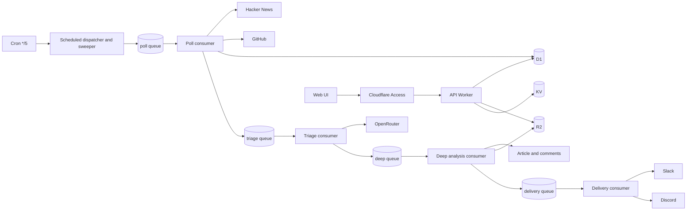
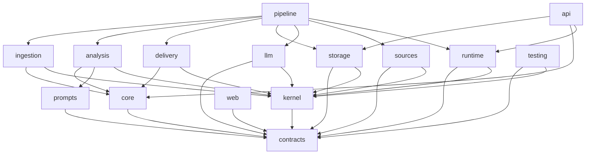

# AI Moves Architecture Plan v1

| Item | Value |
| --- | --- |
| Status | Draft, awaiting review |
| Date | 2026-11-20 |
| Scope | Architecture, decisions, and implementation plan; no application behavior is implemented by this document |
| Terminology | “Worker” means a Cloudflare deployment unit; “implementation worker” means a dispatched coding agent |

## 0. Repository State and Constraints

The repository began empty, with no remote or established project-specific conventions. This document is the durable design baseline; individual long-lived decisions belong in `docs/adr/NNNN-<slug>.md`.

The project is a monorepo with one toolchain, shared contracts, and explicit package boundaries. Cloudflare resources must not be created or changed during local development. Validation begins with local simulation and recorded fixtures. Production deployment, secrets, migrations, and outbound delivery are human authorization gates.

All changes land through pull requests and scoped commits. The repository toolchain is mise, pnpm, oxlint, oxfmt, TypeScript, Vitest, and prek.

## 1. Recommended Shape

1. Use two deployment units: `apps/pipeline` for scheduled work and queue consumers, and `apps/api` for read-only APIs, administrative controls, and static assets.
2. Put shared domain definitions in `packages/contracts`, reusable infrastructure in `packages/kernel`, and each other concern in one named package. Applications only compose packages and bind platform resources.
3. Treat D1 as the authoritative state store and queues as at-least-once wake-up signals.
4. Use deterministic gates before model calls, then AI analysis, then deterministic policy for outbound alerts. A model never directly decides to send.
5. Keep domain code independent of Cloudflare and provider SDKs. Platform and external-service code stays in adapter packages and application roots.
6. Default to low noise: at most eight alerts per destination per day, at most one update per item, no late backfill, and no automatic resend of ambiguous outcomes.

## 2. Component Boundaries and Data Flow

### 2.1 Responsibilities

| Component | Responsibility | Exclusions |
| --- | --- | --- |
| Cron trigger | Fixed five-minute tick | Poll interval semantics live in source configuration |
| Pipeline scheduled handler | Dispatch due sources, sweep stuck work, schedule maintenance | No external HTTP, LLM calls, or item traversal |
| Pipeline queue consumers | Poll, triage, deep analysis, and delivery | Messages carry IDs, not authoritative business data |
| API Worker | Read APIs, administrative overrides, health, static assets | Never holds provider or delivery credentials |
| Queues | Stage decoupling, throttling, batching | Not authoritative state |
| D1 | Correctness-relevant entities, ledgers, audits, and configuration | Large source or model payloads |
| R2 | Content-addressed articles, comments, release notes, prompts, and model payloads | Query indexes |
| KV | Configuration snapshots and short-lived feed cache | Counters, locks, and deduplication |
| OpenRouter | Structured triage, deep analysis, and translation | No tools, network access, or outbound decision |
| Slack and Discord | Independent outbound destinations | No inbound product workflow in the MVP |

### 2.2 End-to-End Flow

| Stage | Trigger | Action | Result |
| --- | --- | --- | --- |
| Schedule | Five-minute cron | Persist due polls, publish ready poll IDs, and sweep expired leases | Poll jobs |
| Poll | Poll queue | Claim persisted work, fetch, persist observations and candidates, and finish the poll with its cursor and next due time | Triage jobs |
| Triage | Triage queue | Check budget, call cheap model, validate schema, persist analysis | Deep-analysis jobs |
| Deep analysis | Deep queue | Fetch source text, store R2 payloads, call strong model, verify citations, decide policy | Alert and deliveries |
| Deliver | Delivery queue | Claim delivery, render, send, persist result | `sent`, classified failure, or `unknown` |
| Compensate | Five-minute cron | Requeue or fail expired nonterminal work | Recovery and operations signal |

### 2.3 Frontend Path

The browser reaches the UI through Cloudflare Access and the API Worker. Feed lists may use a 60-second KV cache; details read directly from the authoritative stores. The Worker validates the Access token audience and signature. The public `workers.dev` route remains disabled.

## 3. Monorepo and Portability

### 3.1 Layout

- `packages/contracts` — shared entities, states, messages, ports, configuration schemas, errors, and alert documents.
- `packages/kernel` — classified errors, logging, configuration loading, clocks, IDs, result helpers, redaction, and timeouts.
- `packages/core` — pure state transitions, idempotency keys, scoring, clustering, and delivery policy.
- `packages/prompts` — prompt templates, output schemas, and evaluation fixtures.
- `packages/storage` — migrations and D1 or in-memory repository implementations.
- `packages/llm` — model adapters, budgets, and fakes.
- `packages/sources` — Hacker News, GitHub, and protected web fetching.
- `packages/ingestion` — scheduling, polling, and sweeping use cases.
- `packages/analysis` — triage, deep analysis, translation, and verification.
- `packages/delivery` — alert decisions, renderers, notifiers, and delivery use cases.
- `packages/runtime-cloudflare` — Cloudflare queue, secrets, telemetry, and handler wiring.
- `packages/testing` — contract suites, fakes, fixtures, and local upstream tools.
- `apps/pipeline` and `apps/api` — deployment composition roots.
- `apps/web` — frontend source; `apps/api` serves the build.
- `tooling` — shared TypeScript, Vitest, and lint configuration.

### 3.2 Dependency Direction

Component packages may not import adapter packages, platform modules, or provider SDKs. Adapter packages do not depend on one another. Application roots are the only packages that select concrete adapters.

### 3.3 Public Package Boundaries

- `contracts` is the only home for shared entities, states, queue schemas, ports, errors, alert content, and configuration schemas.
- `core` owns state transitions, idempotency, scoring, clustering, and outbound policy.
- `kernel` owns classified errors, redaction, logging, and deterministic infrastructure.
- `prompts` owns prompt text, output schemas, and prompt versions.
- Adapter packages own external protocol mapping and provider payload validation.
- `testing` owns reusable test doubles and contract suites; packages do not duplicate them.
- Package consumers import declared public subpaths rather than source internals or broad barrels.

### 3.4 Versions and Deployment Compatibility

Contracts export a contract version. Additive fields are minor changes; removals or semantic changes are major and require an ADR plus migration of every consumer. Queue messages carry a version and consumers accept the current and previous version during rolling releases. D1 migrations use expand and contract phases. Prompt changes produce a new prompt version in the analysis idempotency key.

### 3.5 Deployment Units

The pipeline Worker owns scheduled work, queue consumers, writable storage, blob access, and outbound credentials. The API Worker owns public read paths, administrative writes, and static assets but no external service secrets. Splitting these limits credential exposure and allows independent releases.

### 3.6 Portable Ports

| Port | Cloudflare implementation | Alternative |
| --- | --- | --- |
| `Scheduler` | Cron trigger | EventBridge Scheduler |
| `JobBus` | Queues and DLQs | SQS and DLQs |
| Repositories and ledgers | D1 | Aurora PostgreSQL |
| `BlobStore` | R2 | S3 |
| `ConfigStore` and `Cache` | KV | DynamoDB or AppConfig |
| `LlmClient` | OpenRouter | Bedrock Converse |
| Source clients | Fetch adapters | Equivalent HTTP adapters |
| `Notifier` | Slack and Discord HTTP | Equivalent adapters |
| `SecretProvider` | Worker secrets | Secrets Manager |
| `Telemetry` | Workers Logs | CloudWatch |

Each port has a shared contract suite. Every in-memory and platform implementation must pass it.

### 3.7 Portability Rules

- Do not use Durable Objects, Workflows, Workers AI, AI Gateway, or Vectorize in the MVP without an ADR.
- Queue messages contain IDs and remain below 1 KB.
- Queue delays do not exceed 900 seconds; longer waits use persisted `next_attempt_at` and the sweeper.
- Consumer batches do not exceed 10.
- Every handler is idempotent.
- SQL uses the common SQLite and PostgreSQL subset and stores epoch milliseconds as integers.
- Domain code names logical models; configuration maps them to provider IDs.
- Model output is validated locally after any provider-level schema enforcement, with one repair retry.

## 4. Core Entities and State

### 4.1 Entities

The authoritative model contains sources, items, item snapshots, item revisions, analyses, alerts, deliveries, destinations, budget ledger entries, versioned configuration, and append-only audit entries. Each entity has a stable key and an explicit state or version needed for retries and deduplication.

### 4.2 Idempotency

| Boundary | Key | Repeat behavior |
| --- | --- | --- |
| Poll schedule | `(source_id, tick_bucket)` | Replay wakes the existing slot; a completed bucket cannot be claimed again |
| Item | `external_key` | Upsert updates observation metadata only |
| Revision | `(item_id, content_hash)` | Identical normalized content creates no revision |
| Analysis | `(item_id, stage, input_hash, prompt_version, lang)` | Reuse existing result |
| Alert | Hash of cluster and alert kind | One `new` alert and at most one `update` per cluster |
| Delivery | Hash of alert and destination | Confirm terminal or ambiguous delivery without resending |

State claims use conditional updates. Multi-statement state changes use one atomic D1 batch.

### 4.3 Item State

Items progress from `discovered` to tracking or candidate states, through triage and deep analysis, and then to `feed_only`, `alerted`, or a terminal skip or failure state. A rejected triage may run once more only on a meaningful new revision or a higher heat level. Stuck claims recover through the sweeper and bounded attempts.

### 4.4 Delivery State

A delivery progresses through `pending`, `claimed`, `sent`, retryable failures, and terminal failures. A timeout after the request body was written is `unknown` and is not resent without provider evidence that the first attempt did not commit.

### 4.5 Failure Policy

Errors use the single error-code-to-kind mapping in `contracts`: retryable, permanent, ambiguous, budget, validation, or security. Retry delays are bounded and use jitter. Exhaustion, security failures, and permanent rejection move to terminal states. Recovery writes an audit record when required by policy.

## 5. Two-Stage AI

Cheap triage only receives programmatically selected candidates. Deep analysis receives only triage passes, fetches supporting content, cites evidence, and produces a structured recommendation. Translation is a separate deterministic input to an LLM stage and is never mixed with source extraction.

The output schemas cover triage confidence and rejection reason, deep category and impact, citations, translation, and delivery-neutral alert content. All model output is locally validated. Budgets are checked before and recorded after each call. Model names are logical configuration values that operators may override per environment; overrides are audited.

## 6. Scoring

HN heat is deterministic and uses rank, points, comments, velocity, and item age. GitHub impact uses source priority, release type, semantic version change, and bounded content signals. AI enriches but never replaces the deterministic gate.

Outbound policy combines deterministic evidence, model confidence, citation validity, budget, destination filters, quiet hours, and daily limits. Missing evidence, ambiguous model output, budget exhaustion, or invalid citations prevents delivery.

## 7. Low-Cost Timeliness

Cron persists due poll slots and publishes bounded batches of ready slots. A lost or partially accepted enqueue is retried from storage, not inferred from an acknowledgement. External HTTP, blob reads, and model calls happen only in consumers. Poll intervals are source configuration rather than separate cron schedules. Requests use conditional HTTP headers and small bounded batches. Caches and static assets use short explicit TTLs.

Cloudflare quotas must be watched through local fixtures and documented tests first; production can be enabled only after account-specific limits and billing policies are reviewed.

## 8. Fetching and Translation

GitHub release, tag, and `CHANGELOG` sources have explicit priority, with no commit polling. HN uses official ranked and item data, with deep fetching limited to selected candidates. Web fetching validates DNS and redirects, blocks private networks and non-HTTP protocols, limits response size, and never follows credentials in URLs.

Translation preserves names, code, commands, URLs, versions, and citations. Original and translated content remain separately identifiable in stored output. A failed fidelity check prevents outbound delivery.

## 9. Alert Delivery

Cross-channel deduplication begins with the alert, not with a destination render. Each destination receives one delivery record and an idempotency key. Slack and Discord render from the same channel-neutral `AlertDoc`; neither renderer invents content.

Destinations expose enablement, language, minimum tier, daily budget, source filters, and quiet hours. Manual operators may disable or reprioritize delivery through audited configuration changes, never by editing live queue messages.

## 10. Security

- Store only secret references in persisted domain data.
- Keep the browser-facing Worker free of outbound provider credentials.
- Validate Access assertion signature and audience in the Worker.
- Block SSRF, unapproved redirects, private networks, oversized bodies, and unsupported protocols.
- Redact credentials and sensitive attributes before structured logging.
- Do not record real production payloads in fixtures.
- Give every deployment unit least-privilege bindings and use separate identities for read and write paths where feasible.

## 11. Observability, Health, and Acceptance

Structured logs use stable fields for trace, job, item, stage, state, latency, attempt, and classified error. Metrics include queue age, stage duration, retry count, budget use, and delivery outcomes.

Health checks report dependency readiness without creating product work. Stuck detection uses persisted leases and `next_attempt_at`, then records a recovery attempt. The local acceptance suite proves schema round trips, deterministic state transitions, retries, idempotency, fixture replay, budget boundaries, redaction, and end-to-end compensation.

MVP non-goals include a general search engine, unlimited history, inbound chat workflows, personalized recommendations, arbitrary provider plugins, and autonomous model-driven delivery.

## 12. Local Simulation

Local validation uses in-memory ports, content-addressed temporary blobs, recorded HTTP exchanges, and a local mock upstream. Wrangler or Miniflare can exercise Worker-shaped entry points when available, but the baseline suite must not require Cloudflare credentials or network access.

Differences from cloud behavior remain explicit: local concurrency, queue redelivery, D1 isolation, and Worker limits are imperfect. Contract tests, deterministic clocks, and integration fixtures compensate; they do not claim production equivalence until a deployment review.

## 13. Likely Failure Modes

Primary risks are accidental duplicate delivery, ambiguous provider outcomes, unbounded model or fetch cost, state and queue drift, unsafe URL fetching, prompt or schema drift, and architecture erosion through convenience imports. Mitigations are idempotency keys, one authoritative state store, strict budgets, sweeper recovery, SSRF controls, local schema validation, and generated lint boundaries.

## 14. Implementation Plan

### 14.1 Rules for Every Slice

- Read the current architecture and relevant guidelines before editing.
- Keep the public contract typed and runtime validated.
- Use shared errors, logging, configuration, and deterministic ports.
- Add meaningful behavior tests, especially at boundaries and failure paths.
- Preserve dependency direction and regenerate generated lint configuration.
- Run the complete repository gates before considering the slice complete.

### 14.2 Continuous Implementation Batches

1. Scaffold the workspace, strict TypeScript, lint boundaries, CI, and documentation.
2. Implement contracts and the deterministic kernel.
3. Implement test fakes, contract suites, fixtures, and local upstream simulation.
4. Implement pure core scoring, state transitions, idempotency, and policy.
5. Implement storage migrations and in-memory and D1 repositories.
6. Implement source, LLM, and notifier ports plus adapters.
7. Implement ingestion, analysis, and delivery use cases.
8. Compose Cloudflare bindings and application handlers.
9. Implement the API and frontend.
10. Run local end-to-end scenarios, red-team review, and predeployment acceptance.
11. Require human authorization before resource creation or deployment.

### 14.3 Parallelism and Ownership

Foundation packages precede their consumers. Once public contracts are stable, independent adapter and component slices may proceed in parallel. Each slice owns its tests and public manifest changes; one integration owner resolves shared configuration conflicts.

### 14.4 Integration Order

Integrate contracts, kernel, testing, core, storage, adapters, use cases, composition roots, and UI in that order. A downstream slice may mock an unimplemented port but may not redefine the port or bypass its public package boundary.

### 14.5 Execution Health

A slice is stuck when its required public dependency or explicit acceptance scenario is unavailable, when generated configuration and source disagree, or when the same gate fails without new evidence. Escalate only after recording the failed command, exact blocker, and smallest coordinator action needed.

### 14.6 Upgrade Path

Compatibility work is isolated behind ports and versioned schemas. Provider migration adds an adapter and composition change rather than changing domain packages. Queue and database migrations retain one prior-version compatibility window.

### 14.7 Human Authorization Gates

Creating cloud resources, applying production migrations, changing secrets, granting permissions, enabling real outbound messages, and deploying are never implicit. Each requires explicit target scope and timing from a human operator.

## 15. Owner Decisions

The owner must confirm the production Cloudflare account, final Slack and Discord destinations, provider model identifiers, production budgets, and license before cloud rollout. Engineering defaults remain usable for local implementation and review until those decisions are made.

## Appendix A: External Verification

Values from external platform limits, provider pricing and usage fields, webhook behavior, and service quotas must be rechecked against primary documentation in the slice that first depends on them. Values marked as historical estimates are not acceptance evidence.
