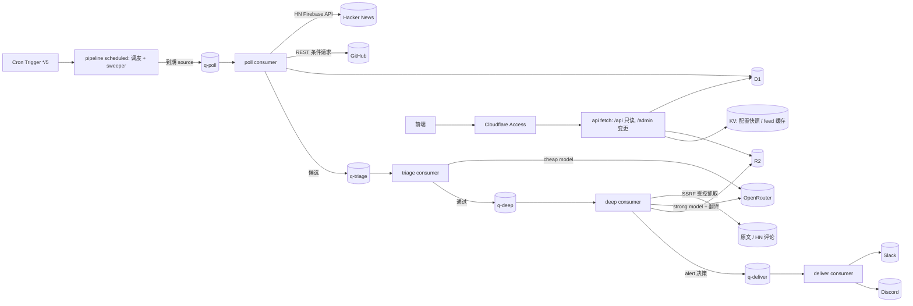
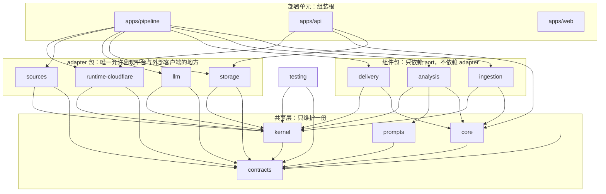
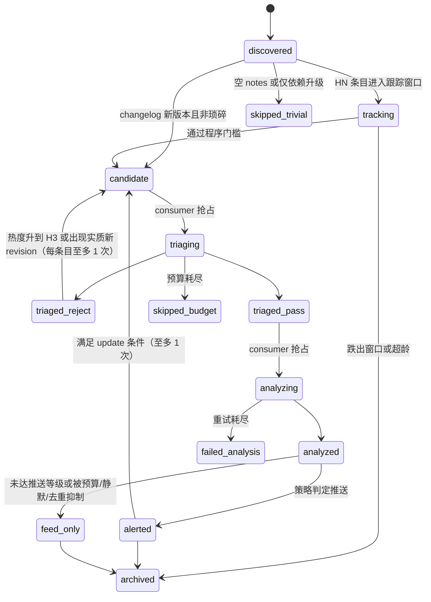

# ai-moves 架构方案 v1

| 项 | 值 |
| --- | --- |
| 状态 | Draft，待评审 |
| 日期 | 2026-11-20 |
| 范围 | 架构、决策与实施规划；不含业务代码实现 |
| 外部事实核实 | 2026-11-20 对照官方文档（附录 A）；标 † 的数值未在本次核实，实现时须复核 |
| 术语 | 「Worker」指 Cloudflare 部署单元；「实施 worker」指被派发的编码 agent |

## 0. 仓库现状与约束

### 0.1 仓库证据

- 仓库为空：唯一提交 `fcd29de`（Initial commit）的树中没有任何文件，`main` 与 `sardine` 指向同一提交，无 remote。
- 因此仓库内**不存在**既有的 docs / ADR / 规格目录约定，也没有 `CLAUDE.md`、`AGENTS.md`、`wrangler` 配置或任何可引用的设计约束文件。
- 本文档放在 `docs/architecture-v1.md`，作为最小且明确的位置。后续单点决策放 `docs/adr/NNNN-<slug>.md`。

### 0.2 协调者给定的约束

| # | 约束 | 在本文档的落点 |
| --- | --- | --- |
| C1 | 协调者主导；只有改变产品、安全、成本或外部行为的决策才上报 owner，其余取保守默认并继续；owner 未答复时也要有可推进的默认 | 14.6、第 15 节 |
| C2 | 项目形式是 monorepo：单仓统一工具链、共享契约与基础设施；`apps` / `packages` 按职责拆分；各包独立测试与版本演进；部署单元明确且可替换；不得复制共享类型、配置、客户端、提示词、状态模型 | 第 3 节 |
| C3 | 当前没有 Cloudflare 权限：先用本地模拟达到同等可验证效果；不创建或修改任何 Cloudflare 资源 | 第 12 节 |
| C4 | 文档须含组件级依赖图、共享包边界、并行切片、集成顺序、健康检查与 stuck detection、升级路径 | 3.2、3.3、11.2、14.3–14.6 |
| C5 | 实施指令须明确要求最佳实践、项目规范、标准化错误 / 日志 / 配置、类型安全、测试、失败恢复、安全审查 | 14.1 |
| C6 | 不停在设计：给出可立即派发的连续实施批次，直到本地端到端运行与上线前验收；真正的部署是最后的人工授权门 | 14.2、14.7 |

### 0.3 仓库外的组织约定

`main` 受保护、所有变更走 PR、一个 PR 一个逻辑变更；生产部署、数据库迁移、密钥轮换须人工在场；工具链为 `pnpm` + `oxlint` + `oxfmt`；工作代码只放 japan-d2 组织。

## 1. 推荐方案摘要

1. **Monorepo，两个部署单元**。`apps/pipeline`（`scheduled` + 四个队列 consumer）与 `apps/api`（只读 API、管理接口、前端静态资源）。组件逻辑在 `packages/*`，`apps/*` 只做组装。
2. **共享契约只有一份**。类型、状态枚举、队列消息、port 接口、配置 schema、错误码都在 `packages/contracts`；提示词只在 `packages/prompts`；客户端只在各自的 adapter 包。lint 规则强制依赖方向。
3. **D1 是唯一事实来源，队列只是唤醒信号**。每个阶段先写状态再入队；sweeper 按状态与时间重新入队，补偿丢失或卡住的消息。
4. **程序先筛，AI 后判，策略定推送**。AI 只看通过程序门槛的候选；是否推送由确定性策略（AI 评级 + 程序证据 + 引文校验 + 通知预算）决定，AI 单独无权触发外发。
5. **领域代码零平台依赖**。Cloudflare 与 OpenRouter 只出现在 adapter 包与 `apps/*`，换 AWS / Bedrock 是新增 adapter 与组装根。
6. **本地优先验证**。全部验收在 Wrangler / Miniflare 本地模拟与录制夹具上完成；创建云资源、写入密钥、部署、启用真实发送是最后的人工授权门。
7. **默认低噪声参数**：每目标渠道 8 条/天、每条目最多 1 次更新、过期不补发、歧义失败不自动重发。



## 2. 组件边界与数据流（问题 1）

### 2.1 各组件职责

| 组件 | 职责 | 明确不做 |
| --- | --- | --- |
| Cron Trigger | 单个固定表达式 `*/5 * * * *`，触发 `apps/pipeline` 的 `scheduled` | 不承载采样间隔语义；间隔由 `source.poll_interval_sec` 决定，改间隔无需重新部署 |
| `apps/pipeline` `scheduled` | 查到期 source → 入 `q-poll`；sweeper 重新入队卡住的条目；每日一次维护任务入队 | 不发任何外部 HTTP，不调 LLM，不遍历条目 |
| `apps/pipeline` `queue` | poll / triage / deep / deliver 四类 consumer，承担所有外部 I/O | 不依赖消息体携带业务数据，消息只带 ID |
| `apps/api` `fetch` | `/api/*` 只读、`/admin/*` 开关与人工覆盖、`/healthz`、前端静态资源 | 不同步触发抓取或分析；`/admin` 的强制分析只是入队。不持有 OpenRouter、GitHub、webhook 密钥 |
| Queues | `q-poll`、`q-triage`、`q-deep`、`q-deliver` + 每条队列一个 DLQ；阶段解耦、限流、批处理 | 不作为状态存储；消息丢失不影响正确性 |
| D1 | 全部正确性相关状态：source、item、snapshot、analysis、alert、delivery、预算账本、审计、配置版本 | 不存大文本正文 |
| R2 | 内容寻址的原始载荷：原文抽取文本、HN 评论树、release notes 原文、LLM 请求/响应记录、deep 分析正文 | 不做查询索引 |
| KV | 读多写少：当前配置快照、feed 列表缓存（TTL 60 s）、kill switch 传播 | 不做计数器、锁、去重（最终一致，且同键 1 写/秒） |
| OpenRouter | triage / deep / translate 三类结构化推理 | 无工具、无联网、不决定是否外发 |
| GitHub | watchlist 仓库的 release、tag、CHANGELOG 文件 | 不轮询 commit |
| Hacker News | `topstories` 排名与条目计数（Firebase）；deep 阶段的评论树 | 不抓 `newstories` 全量 |
| Slack / Discord | 出站告警渠道，各自独立的 delivery 记录 | MVP 无入站交互 |

### 2.2 端到端数据流

| 步骤 | 触发 | 动作 | 产出 |
| --- | --- | --- | --- |
| 1 调度 | cron 每 5 分钟 | 1 条 D1 查询取 `next_poll_at <= now` 的 source，`sendBatch` 入 `q-poll`，推进 `next_poll_at` | poll 消息 `{v, source_id, tick_bucket}` |
| 2 采样 | `q-poll` | adapter 拉取 → upsert item → 写 snapshot / revision → 计算程序特征与分数 → 判定门槛 | 候选条目入 `q-triage` |
| 3 快筛 | `q-triage`（批 ≤ 8） | 预算检查 → cheap model 结构化输出 → 本地 schema 校验 → 落 analysis | 通过者入 `q-deep` |
| 4 深析 | `q-deep`（单条） | 抓原文与评论 → 存 R2 → strong model → 引文校验 → 策略决策 → 需要时翻译 | `alert` 行 + 每目标一条 `delivery` 入 `q-deliver` |
| 5 投递 | `q-deliver`（单条） | 抢占 delivery 行 → 渲染 → 发送 → 记录结果 | `sent` / `failed_*` / `unknown` |
| 6 补偿 | cron 每 5 分钟 | sweeper 扫描非终态且超过租约的行，重新入队或标记失败 | 自愈；DLQ 触发 ops 告警 |

### 2.3 前端读取路径

- 浏览器 → Cloudflare Access（SSO）→ `apps/api` → D1（feed 列表、条目时间线、source 健康、delivery 记录）与 R2（分析正文、原文摘录）。
- feed 列表经 KV 缓存 60 s；条目详情直读。
- 前端永不直连 OpenRouter / GitHub / HN / Slack / Discord，也不持有任何密钥。
- 静态资源由 `apps/api` 以 Workers Static Assets 提供，与 API 同源。
- Worker 内校验 `Cf-Access-Jwt-Assertion` 的签名与 audience，不仅依赖网络层；`workers.dev` 路由关闭。

## 3. Monorepo 结构、共享包边界与可移植性（问题 2）

### 3.1 目录与包

```
apps/
  pipeline/            Worker：scheduled + 4 个 queue consumer（部署单元 1）
  api/                 Worker：fetch API + 静态资源（部署单元 2）
  web/                 前端源码，构建产物由 apps/api 提供
packages/
  contracts/           共享契约：实体类型、状态枚举、队列消息、port 接口、配置 schema、错误码、AlertDoc
  kernel/              共享基础设施：错误模型、日志、配置加载、Clock / IdGen、Result
  core/                领域逻辑：状态迁移、幂等键、评分、聚簇、推送策略（纯函数）
  prompts/             提示词模板、输出 schema、版本号、评测夹具
  storage/             迁移、repo 实现（D1 与 in-memory）、BlobStore、ConfigStore
  llm/                 LlmClient：OpenRouter adapter、fake、预算守卫（后续 Bedrock）
  sources/             HnClient、GitHubClient、WebFetcher（含 SSRF 防护）
  ingestion/           用例：tick、pollSource、sweeper
  analysis/            用例：triageBatch、analyzeItem、translate、引文与保真校验
  delivery/            用例：decideAlert、渲染器、Slack / Discord notifier、deliver
  runtime-cloudflare/  Queues JobBus、SecretProvider、Telemetry、handler 组装辅助
  testing/             契约测试套件、fake、录制夹具、上游 mock 服务、E2E 工具
tooling/               共享 tsconfig、oxlint 与 oxfmt 配置
docs/                  本文档与 adr/
```

统一工具链：`pnpm` workspace（依赖用 `workspace:*`）、TypeScript `strict` + project references、`oxlint`、`oxfmt`、单一测试框架、单一 CI。每个包有自己的 `test` / `typecheck` / `lint` 脚本，可用 `pnpm --filter <pkg>` 独立运行。

### 3.2 组件级依赖图



### 3.3 共享包边界：每类东西只有一个家

| 共享物 | 唯一位置 | 其他包的用法 | 强制手段 |
| --- | --- | --- | --- |
| 实体类型、状态枚举、队列消息 schema、port 接口、错误码、`AlertDoc`、配置 schema | `contracts` | 只能 import，不得本地重新声明 | 依赖方向 lint；评审清单 |
| 状态迁移规则、幂等键构造、评分、推送策略 | `core` | 组件包调用，不自行判断状态 | 状态写入只经 `core` 的迁移函数 |
| 错误模型、日志、配置加载 | `kernel` | 所有包统一使用 | 禁止 `console.*` 与裸 `throw new Error` 的 lint 规则 |
| 提示词、输出 schema、提示词版本 | `prompts` | `analysis` 引用 | 其他包出现提示词字符串视为评审阻断项 |
| LLM 调用与预算检查 | `llm` | 经 `LlmClient` port 注入 | 裸 `fetch` 只允许出现在 `sources`、`llm`、`delivery` 的 notifier 目录 |
| HN / GitHub / 网页抓取客户端 | `sources` | 经 port 注入 | 同上 |
| 持久化、迁移 | `storage` | 经 repo port 注入 | SQL 只允许出现在 `storage` |
| fake、夹具、契约测试套件 | `testing` | 所有包的测试复用 | 不得在各包内复制 fake |

依赖规则：

- 组件包（`ingestion`、`analysis`、`delivery`）与 `core`、`prompts` 禁止 import `cloudflare:*`、`@cloudflare/*`、任何 provider SDK、任何 adapter 包。
- adapter 包之间互不依赖；组件包之间互不依赖。跨组件协作只经 D1 状态与队列消息。
- `apps/*` 是唯一知道具体 adapter 的地方。

### 3.4 版本演进

| 对象 | 规则 |
| --- | --- |
| 各包 | 各自 `package.json` 的 semver；均为私有包，不发布到 registry |
| `contracts` | 导出 `CONTRACT_VERSION`。新增字段是 minor；删除或改语义是 major，须先写 ADR、经协调者批准，并在同一组 PR 里更新所有消费者 |
| 队列消息 | 每条消息带 `v`；consumer 必须能处理当前与上一个版本，保证两个部署单元可以先后部署 |
| D1 schema | expand / contract 两步迁移：先加后删，任何单次迁移都与上一版代码兼容 |
| 提示词 | `prompt_version` 进入 analysis 幂等键；改提示词即产生新版本，旧结果不被覆盖 |

### 3.5 部署单元

| 部署单元 | 入口 | 绑定 | 持有的密钥 |
| --- | --- | --- | --- |
| `apps/pipeline` | `scheduled`、`queue`（按队列名分发到四个 consumer） | D1 读写、R2 读写、KV 读、四条队列的 producer 与 consumer | OpenRouter key、GitHub token、各 webhook URL |
| `apps/api`（含 `apps/web` 产物） | `fetch` | D1 读写（仅配置、覆盖、审计）、R2 读、KV 读写、队列 producer | 无外部服务密钥；只有 Access 的 audience 配置 |

- 拆成两个单元的理由是最小权限与发布隔离：面向浏览器的单元拿不到任何出站密钥；前端与 API 的发布不会影响采样管线。
- 四个 consumer 各自是组件包导出的独立 handler。将来要把 ingestion、analysis、delivery 拆成独立 Worker，或把某个 consumer 换成 Lambda，只改 `apps/*` 的组装，不改组件包。

### 3.6 Port 与 AWS 映射

| Port（定义在 `contracts`） | 职责 | Cloudflare 实现 | AWS 目标 |
| --- | --- | --- | --- |
| `Scheduler`（入站） | 周期 tick | Cron Trigger | EventBridge Scheduler |
| `JobBus` | `enqueue(job, {delaySeconds})` | Queues（`runtime-cloudflare`） | SQS + DLQ |
| `*Repo`、`BudgetLedger`、`AuditLog` | 领域语义的持久化操作 | D1（`storage`） | Aurora Serverless v2（PostgreSQL） |
| `BlobStore` | 内容寻址读写 | R2 | S3 |
| `ConfigStore` / `Cache` | 配置快照、短 TTL 缓存 | KV | DynamoDB 或 AppConfig |
| `LlmClient` | `generateStructured({stage, schema, messages})` | OpenRouter Chat Completions（`llm`） | Bedrock Converse |
| `HnClient`、`GitHubClient`、`WebFetcher` | 源抓取与受控网页抓取 | 标准 `fetch`（`sources`） | 同一实现；`WebFetcher` 的文本抽取与 DNS 校验按平台替换 |
| `Notifier` | `send(dest, AlertDoc, idempotencyKey)` | Slack / Discord HTTP（`delivery`） | 同一实现 |
| `SecretProvider` | 按引用名取密钥 | Workers Secrets | Secrets Manager |
| `Telemetry` | 结构化日志、计数 | Workers Logs | CloudWatch |

每个 port 在 `testing` 里有一套契约测试；in-memory 实现与 Cloudflare 实现必须通过同一套用例，将来的 AWS adapter 以通过契约测试为验收。

### 3.7 为可移植性现在就定下的规则

| 规则 | 原因 |
| --- | --- |
| MVP 禁用 Durable Objects、Workflows、Workers AI、AI Gateway、Vectorize；确需使用须先写 ADR | 这些在 AWS 侧没有等价的直接替换 |
| 队列消息只带 ID，≤ 1 KB | 两边消息上限不同，且状态以 D1 为准 |
| `delaySeconds` 不超过 900 s；更长的延迟用 `next_attempt_at` + sweeper | SQS 延迟上限 15 分钟† |
| consumer 批大小 ≤ 10 | SQS 批上限 10† |
| 所有 handler 幂等 | Queues 与 SQS 标准队列都是至少一次投递 |
| SQL 只用 SQLite 与 PostgreSQL 的公共子集：`ON CONFLICT DO NOTHING/UPDATE`，时间存 epoch 毫秒整数，查询里不用 JSON1 函数 | D1 → PostgreSQL 时只换方言层 |
| 领域层用逻辑模型名 `triage` / `deep` / `translate`，由配置映射到 provider 的模型 ID | 换 Bedrock 只改映射 |
| `LlmClient` 无论 provider 是否强制 schema，都在本地做 schema 校验 + 1 次修复重试 | OpenRouter 的 strict 强制程度因上游 provider 而异；Bedrock 的结构化输出机制不同 |
| 默认选 Claude 系列模型 | Bedrock 上有同系列模型，迁移时提示词与评测集可沿用 |

## 4. 核心实体与状态机（问题 3）

### 4.1 实体

| 实体 | 关键字段 | 唯一键 |
| --- | --- | --- |
| `source` | `kind`（`hn_top` / `github_repo`）、`config_json`、`poll_interval_sec`、`next_poll_at`、`cursor_json`（etag、上次版本集）、`consecutive_failures`、`status` | `key`，如 `hn:top`、`github:owner/repo` |
| `item` | `source_id`、`kind`、`url`、`title`、`published_at`、`content_hash`、`revision`、`state`、`state_updated_at`、`score_json`、`tier`、`cluster_id`、`attempts`、`next_attempt_at` | `external_key`，如 `hn:12345`、`gh:owner/repo@1.2.3` |
| `item_snapshot`（HN） | `rank`、`points`、`comments` | `(item_id, sampled_at)`，`sampled_at` 对齐 tick 桶 |
| `item_revision`（changelog） | `origin`（`release` / `tag` / `changelog_file`）、`r2_key`、`observed_at` | `(item_id, content_hash)` |
| `analysis` | `stage`、`model`、`prompt_version`、`config_version`、`status`、`output_json` 或 `r2_key`、`usage_json` | `(item_id, stage, input_hash, prompt_version, lang)` |
| `alert` | `item_id`、`analysis_id`、`tier`、`kind`（`new` / `update`）、`decision`、`decision_reason_json` | `alert_key = hash(cluster_id, kind)` |
| `delivery` | `alert_id`、`destination_id`、`state`、`attempts`、`provider_message_id`、`last_error`、`next_attempt_at` | `idempotency_key = hash(alert_key, destination_id)` |
| `destination` | `channel`、`secret_ref`、`lang`、`enabled`、`min_tier`、`daily_budget`、`source_filters`、`quiet_hours` | `name` |
| `budget_ledger` | `used`、`limit` | `(day, scope)` |
| `config` | 版本化配置 JSON | `version` |
| `audit_log` | `actor`、`action`、`target`、`detail_json`；只追加 | `id` |

`alert` 是在任务列出的五类实体之外增加的一层，用来把「一次推送决策」与「N 个渠道的投递」分开，跨渠道幂等依赖它。

### 4.2 幂等键

| 层 | 幂等键 | 重复时的行为 |
| --- | --- | --- |
| 调度 | `(source_id, tick_bucket)`，`tick_bucket = floor(scheduled_time / interval)` | snapshot 主键冲突，无新行 |
| 条目 | `external_key` | upsert 只更新 `last_seen_at` |
| 版本 | `(item_id, content_hash)`，hash 取归一化后的正文 | 相同内容不产生新 revision |
| 分析 | `(item_id, stage, input_hash, prompt_version, lang)` | 直接复用已有结果，不再调用 LLM |
| 告警 | `alert_key`，按去重簇而非单条目 | 同簇只有一条 `new` 和至多一条 `update` |
| 投递 | `idempotency_key` | 行已是 `sent` 或 `unknown` 时直接确认消息 |

阶段抢占统一用条件更新：`UPDATE item SET state = :next WHERE id = :id AND state = :expected`，受影响行数为 1 才继续。多语句写入用 D1 `batch()` 保证原子性。

### 4.3 条目状态机



### 4.4 投递状态机

| 状态 | 进入条件 | 后续 |
| --- | --- | --- |
| `pending` | alert 决策为 `send` 时为每个启用的目标创建 | 入 `q-deliver` |
| `sending` | consumer 条件更新抢占成功 | 发送 |
| `sent` | 收到 2xx | 终态；记录 `provider_message_id`（Discord 有，Slack webhook 无） |
| `failed_retryable` | 429、已收到的 5xx、连接建立前失败 | 按 `Retry-After` 或 30 s / 2 min / 10 min / 30 min 退避，最多 5 次 |
| `failed_permanent` | 4xx（webhook 被删、载荷非法、频道归档） | 终态；禁用该目标并发 ops 告警 |
| `unknown` | 请求体已发出后超时，结果不可知 | 终态；**不自动重试**，在运维视图里可人工重发 |
| `expired` | 超过时效（HN 6 h、changelog 24 h）仍未发出 | 终态；迟到的告警本身就是噪声 |
| `suppressed` | 预算、静默时段、mute、目标被禁用 | 终态；条目仍在前端 feed 可见 |

### 4.5 重试与失败补偿

| 阶段 | 重试 | 耗尽后 |
| --- | --- | --- |
| poll | source 级指数退避，上限 1 h；`consecutive_failures >= 3` 置 `degraded` | 超过 3 个间隔无成功采样 → ops 告警 |
| triage / deep | 队列重试 3 次；schema 校验失败做 1 次修复重试，仍失败则换 fallback 模型 1 次 | `failed_analysis`，前端可见，可人工重跑 |
| deliver | 见 4.4 | DLQ + ops 告警 |
| 入队丢失 / consumer 崩溃 | sweeper 扫描 `state_updated_at` 超过阶段租约（triage 10 min、deep 15 min、deliver 5 min）的非终态行 | `attempts` 超限则转失败终态 |
| 各渠道 | 互相独立 | Slack 成功、Discord 失败时只重试 Discord |

统一的错误分类在 `kernel`：每个错误带 `kind`（`retryable` / `permanent` / `ambiguous` / `budget` / `validation` / `security`），consumer 只按 `kind` 决定确认、重试或转终态，不各自解释 HTTP 状态码。

## 5. 两阶段 AI（问题 4）

### 5.1 触发阈值

| 阶段 | 输入 | 进入条件 |
| --- | --- | --- |
| triage | 标题、域名、程序特征摘要、release notes 逐条（截断到 600 token/条目）、近 72 h 已推送标题列表 | HN：通过 6.1 的任一程序门槛；changelog：新版本或实质新 revision，且非琐碎 |
| deep（HN） | 原文抽取文本 ≤ 6k token、筛选后的评论 ≤ 5k token、程序特征 | triage `relevance >= 2` 且 `substance >= 2` 且非重复；并且评论数 ≥ 15 或 triage 通过已满 30 分钟 |
| deep（changelog） | 完整 notes、与上一版本的差异、新增表面标记列表 | triage `impact >= 2`；或 `impact == 1` 且程序先验 ≥ 50 |
| translate | deep 的规范化英文输出 | alert 决策为 `send`，且至少一个启用的目标配置了 `zh-CN` 或 `ja` |

### 5.2 结构化输出

- 请求统一带 JSON Schema 且 `strict: true`，并要求上游 provider 支持该参数；adapter 本地再校验一次。
- triage 输出（批内每条目一份）：

| 字段 | 取值 | 说明 |
| --- | --- | --- |
| `relevance` | 0–3 | 对照配置里的关注画像 |
| `substance` | 0–3 | 是否有技术实质 |
| `impact` | 0–3 | 仅 changelog |
| `entries[]` | `{index, change_type, user_action_required}` | 仅 changelog；`change_type` ∈ `workflow` / `config` / `capability_boundary` / `default_behavior` / `breaking` / `perf` / `fix` / `internal` / `docs` |
| `dup_of` | 已推送条目 ID 或 null | 语义去重 |
| `reason` | ≤ 200 字符 | 人可读的一句话理由 |
| `evidence_quotes[]` | 原文逐字片段 | 程序校验是否为输入的子串 |

- deep 输出：`summary`、`key_points[]`、`engineering_implications[]`、`discussion_viewpoints[]`（`stance`、`claim`、`comment_ids[]`）、`nonredundant_insights[]`（评论中有而原文没有的信息）、`trend`（`direction`、`horizon`、`confidence`、`rationale`）、`importance`（1–5，附评分细则对应项）、`caveats[]`。每个 `key_points` 与 `nonredundant_insights` 条目必须带 `evidence_quote` 或 `comment_id`。
- 每条 analysis 记录 `model`、`prompt_version`、`config_version`、`input_hash`、token 用量与费用，保证任何一条告警都能复盘。

### 5.3 预算上限

| 项 | 默认值 | 强制位置 |
| --- | --- | --- |
| triage 条目数 | 200 条/天 | D1 `budget_ledger`，调用前检查 |
| deep 次数 | 20 次/天 | 同上 |
| translate 次数 | 每条已决定推送的 alert × 启用语言数 | 同上 |
| 单次输入上限 | triage 批 6k token，deep 12k token | 提示词构造器截断 |
| 月度费用硬上限 | 待 owner 确认（第 15 节 Q1） | OpenRouter 侧 API key 预算，作为外层保险丝 |
| 账本记账 | 以 OpenRouter 响应里的用量与费用†为准 | adapter 回写 |

- 预算耗尽时：按程序分数从高到低处理，余下标 `skipped_budget` 并发一次 ops 通知；不排队到次日。
- kill switch：`ai.enabled = false` 后 triage / deep consumer 直接确认消息并把条目留在 `candidate`，恢复后由 sweeper 续跑。

### 5.4 模型可配置与人工覆盖

- 配置：`models.{triage,deep,translate} = {provider, model, fallbacks[], max_output_tokens}`。默认 triage 与 translate 用 Claude Haiku 级，deep 用 Claude Sonnet 级；具体 slug 在切片 S1.3 对照 OpenRouter 模型页选定，须支持 structured outputs。
- 可按 source 覆盖模型。
- 人工覆盖（`/admin`，全部写 `audit_log`）：强制分析某条目、强制发送、撤销待发、mute 仓库 / 域名 / 关键词（带 TTL）、暂停某目标、暂停全部 AI、调整阈值（生成新 `config_version`）。
- 静态结构配置（watchlist、默认阈值、提示词）在仓库内经 PR 变更；运行期开关走 `/admin`。

## 6. 评分定义（问题 5）

原则：**「新出现」只会开始跟踪，从不构成推送理由**。推送需要同时满足程序证据与 AI 评级，且每条告警都带一行「为什么是现在」。

### 6.1 HN 热度（全部程序化）

特征（窗口 W = 30 分钟，至少 2 个样本才计算）：

| 特征 | 定义 |
| --- | --- |
| `vp` | W 内得分增量 / W，单位 points/h |
| `vc` | W 内评论增量 / W，单位 comments/h |
| `acc` | 当前 `vp` − 上一个窗口的 `vp` |
| `climb` | W 前排名 − 当前排名；窗口内新进榜按 `N + 1 − rank` 计 |
| `points`、`comments`、`rank`、`age_h` | 当前值 |

归一化：`P(x)` 是 x 在「同龄桶」（0–1 h、1–3 h、3–6 h、6–12 h、12–24 h、> 24 h）最近 7 天样本中的分位数，每日重算一次基线。这样消除了时段与年龄偏差，也避免绝对阈值。

```
heat = 100 × (0.35·P(vp) + 0.25·P(vc) + 0.15·P(climb) + 0.15·P(acc) + 0.10·P(points))
```

| 等级 | 条件 |
| --- | --- |
| H1 | `heat >= 70` |
| H2 | `heat >= 85` |
| H3 | `heat >= 95` |

进入 triage 的程序门槛（满足任一）：

| 门槛 | 条件 |
| --- | --- |
| G1 爆发 | 连续 2 个样本 `heat >= 70`，或单样本 `heat >= 90`；且 `points >= 20`、`age_h <= 24` |
| G2 讨论激增 | `P(vc) >= 0.90` 且 `comments >= 30` |
| G3 持续高位 | 连续 3 个样本 `rank <= 10` |

排除：`type = job`、已删除或 dead、命中 mute、已在同级或更高等级处理过。冷启动（基线不足 3 天）时用固定回退值 `vp >= 60/h` 或 `vc >= 40/h`，这两个数须在影子运行期校准。

### 6.2 changelog 影响度

程序先验 `prior`（0–100，逐项可列出命中的原文行）：

| 信号 | 分值 |
| --- | --- |
| 新增表面标记：本仓库历史 notes 中从未出现过的 CLI flag、配置键、环境变量、斜杠命令 | +30（封顶） |
| breaking / deprecate / remove / migrate 词表命中 | +25 |
| 默认行为变化词表命中（`now default`、`by default`、`no longer`） | +15 |
| notes 长度相对该仓库中位数 z-score > 1 | +10 |
| semver 为 minor 或 major | +10 |
| semver 为 patch | 0（不扣分） |
| 条目全部匹配 fix / 依赖升级模式 | −20 |
| prerelease | −10 |

- semver 只是弱先验，**不作为门槛**：AI 编码工具经常在 patch 版本里交付改变工作流的功能，所以所有非琐碎的新版本都进 triage。
- 单仓库每天最多 3 次 triage；超过时合并多个版本的 notes 做一次 triage（应对 nightly 高频发布）。

### 6.3 程序与 AI 的分工

| 判断 | 归属 |
| --- | --- |
| 增量、排名变化、速度、加速度、分位数、等级 | 程序 |
| 版本识别、多源合并、内容 hash、新增表面标记、词表命中 | 程序 |
| URL 规范化去重、跨源聚簇 | 程序 |
| 与关注画像的相关性、技术实质 | AI（triage） |
| 每条 changelog 条目的变更类型、是否需要用户动作 | AI（triage） |
| 与近期已推送内容的语义重复 | AI（triage），输入的候选列表由程序提供 |
| 工程启示、讨论观点、非冗余洞见、趋势判断、`importance` | AI（deep） |
| AI 引用的原文片段是否真实存在 | 程序（子串校验） |
| 是否推送、推到哪里 | 程序策略 |

### 6.4 推送判定

| 类型 | 推送条件 |
| --- | --- |
| HN | `importance >= 4`；或 `importance == 3` 且热度 ≥ H2 |
| changelog | deep `impact == 3`；或 `impact == 2` 且 `prior >= 40` |
| 共同前提 | 引文校验通过、未标记疑似注入、未被 mute、通知预算有余量、不在静默时段、同簇未推送过 |

不满足的条目进前端 feed，带上被拦下的原因。每条告警的「为什么是现在」由程序生成，例如「得分速度 142/h（同龄 P97），评论 61/h（P95），30 分钟内排名 38→6」或「新增配置键 2 个，命中 breaking 词表 1 处」。

## 7. 低成本实时性（问题 6）

### 7.1 绝不能阻塞 cron 的阶段

`scheduled` 的全部工作是 ≤ 2 条 D1 查询加 1 次 `sendBatch`，目标墙钟 < 1 s。以下一律不在 cron 内执行：任何外部 HTTP（HN、GitHub、原文、OpenRouter、Slack、Discord）、任何 LLM 调用、按条目的循环、R2 大对象读写。cron 失败不重试，下一个 tick 靠 `next_poll_at <= now` 自然补上。

### 7.2 采样与配额

| 项 | 设计 | 量级 |
| --- | --- | --- |
| 基础 tick | `*/5`；source 间隔须为 5 分钟的整数倍，默认 600 s | 288 次调用/天 |
| HN | 每次 1 个 `topstories` + 前 60 名与仍在跟踪条目的 item 请求，上限 90；并发 ≤ 6 | ≈ 9k–13k 请求/天；官方文档写明目前无速率限制 |
| GitHub | 每仓库 1–2 个带 ETag 的条件请求，仓库间串行；每条 poll 消息 ≤ 10 个仓库 | 30 个仓库 ≈ 8.6k 请求/天；304 不计入主限额；须带 token（未认证为 60 次/h†，在共享出口 IP 上不可用） |
| 队列操作 | 消息只带 ID；每条消息约 3 次操作 | < 1k 消息/天，≈ 9 万次操作/月，远低于 Paid 含的 100 万 |
| D1 写入 | snapshot 仅在数值变化时写；72 h 后清理，条目上保留峰值聚合 | 约 2–3 万行/天（含索引） |
| KV 写入 | 仅配置变更与 feed 缓存刷新 | 远低于每天 1,000 |

### 7.3 批处理与缓存

| 队列 | `max_batch_size` | `max_batch_timeout` | `max_concurrency` | 说明 |
| --- | --- | --- | --- | --- |
| `q-poll` | 1 | — | 2 | GitHub 请求串行，避免二级限流 |
| `q-triage` | 8 | 30 s | 1 | 攒批后一次 LLM 调用 |
| `q-deep` | 1 | — | 2 | 单条独立失败 |
| `q-deliver` | 1 | — | 1 | 天然满足渠道速率限制 |

- GitHub 用 ETag 条件请求；原文按 `content_hash` 内容寻址，同一 URL 24 h 内不重抓；analysis 按幂等键复用。
- 延迟目标（P95）：changelog 从发布到送达 ≤ 15 分钟；HN 从越过门槛到送达 ≤ 25 分钟（含 2 样本去抖）。

### 7.4 Cloudflare 档位风险

| 限制 | Free | Paid | 对本设计的影响 |
| --- | --- | --- | --- |
| CPU / 调用 | 10 ms | 默认 30 s，可调至 5 min | Free 下解析 500 个 ID、60 个 item 再做评分会超限 |
| subrequests / 调用 | 50 | 默认 10,000 | HN 一次采样 61–91 个请求，Free 下必须拆分 |
| D1 查询 / 调用 | 50 | 1,000 | 无论哪档都用 `batch()` |
| Cron Triggers / 账号 | 5 | 1,000 | 本设计只用 1 个 |
| cron 墙钟 | 15 min | 15 min | 不相关，cron 目标 < 1 s |
| Queues 操作 | 10,000/天，保留 24 h | 100 万/月含，之后 $0.40/百万；保留默认 4 天 | Free 下故障超过 24 h 会丢消息；本设计靠 sweeper 恢复 |
| D1 | 500 万行读/天、10 万行写/天、单库 500 MB | 250 亿读/月、5,000 万写/月、单库 10 GB | 不构成瓶颈 |
| KV | 10 万读/天、1,000 写/天 | 1,000 万读/月、100 万写/月 | 禁止按 tick 写 KV |
| R2 | 10 GB-月、100 万 A 类、1,000 万 B 类操作/月免费 | 同左，超出计费 | 原始载荷 30 天、分析 180 天的生命周期规则 |

默认决策：生产用 Workers Paid；Free 仅用于 dev 环境，并接受其降级行为。本地模拟不强制这些限额，所以每个 handler 的外部请求数与 D1 查询数由测试断言（12.3）。

## 8. 抓取与翻译策略（问题 7）

### 8.1 GitHub 多源优先级

| 优先级 | 来源 | 用途 |
| --- | --- | --- |
| 1 | Releases API（`releases?per_page=10`） | 版本发现 + notes 正文；包含 prerelease 标记 |
| 2 | 仓库内 `CHANGELOG.md`（contents API，按 sha 判变化） | release 正文为空或自动生成时，按版本标题切段取对应章节 |
| 3 | Tags API | 仅用于发现「有 tag 无 release」的版本 |
| 4 | compare API | 仅在 deep 阶段、notes 仍为空时按需取一次，作为上下文；commit 信息本身永不触发告警 |

- 每个仓库配置 `strategy`：`release_first`（默认）、`changelog_file`、`tags_plus_changelog`。watchlist 中每个仓库实际用哪种，在切片 S1.4 逐一核实后写入种子配置。
- 多源收敛到同一个 item：`external_key = gh:{owner}/{repo}@{归一化版本号}`；版本号去掉 `v` 前缀与包名前缀（monorepo 的 `pkg@1.2.3` 保留包名作为键的一部分）。
- release 正文在发布后被补写很常见：归一化正文 hash 变化即产生新 revision；差异少于 200 字符或只是空白与链接变化则不重新 triage。
- 凭证只发往 `api.github.com`。

### 8.2 HN 原文与评论

- 排名与计数：Firebase `topstories` + `item/{id}`，作为事实来源。
- 评论：仅在 deep 阶段抓取，一次请求取整棵评论树（Algolia `items/{id}`†）；失败时回退到 Firebase 按 `kids` 广度优先，上限 60 个请求。Algolia 的速率限制按 IP 计†，共享出口 IP 上有被限流风险，所以不用于每 tick 的采样。
- 评论筛选（程序化）：按 HN 自身的排序取前 30 个顶层线程，深度 ≤ 2，单条截断 800 字符，去掉已删除与近重复，总量 ≤ 5k token；保留 `comment_id` 以便引用。
- 原文：经 `WebFetcher`（第 10 节）抓取，抽取正文文本，截断到 6k token。抓取失败、付费墙、非 HTML 时，deep 只基于标题与评论进行，并在输出里注明「未读取原文」。
- Ask HN / Show HN 没有外链时，以帖子正文为原文。

### 8.3 翻译与原文保真

| 规则 | 说明 |
| --- | --- |
| 规范语言 | deep 分析一律以英文产出并落库，翻译是独立的后置步骤 |
| 可选语言 | 每个目标配置 `lang`：`en`（不翻译）、`zh-CN`、`ja`；只为实际要发送的告警生成译文 |
| 始终保留原文 | 原标题原样显示，译文标题另起一行；每条告警带原文链接与 HN 讨论链接 |
| 不翻译的内容 | 代码、CLI flag、配置键、环境变量、版本号、产品与模型名、URL、人名与 ID |
| 引用 | 引文保留原文，译文附后，不替换 |
| 保真校验（程序） | 译文中的 URL、反引号片段、版本号、数字集合必须与英文版一致；不一致则重试 1 次，仍失败就发送英文版并标注 |
| 语言纯度 | 日文与中文分别调用，不在同一次请求里产出两种语言；译文提示词要求按目标语言母语习惯书写 |
| 标注 | 译文块标明为机器翻译 |
| 不做 | 不翻译原文全文，不翻译整棵评论树 |

## 9. 告警投递（问题 8）

### 9.1 去重与跨渠道幂等

- 聚簇：URL 规范化（去追踪参数、统一 scheme 与尾斜杠、解析常见短链）后取 hash；HN 条目链接指向 watchlist 仓库的 release 或 tag 页面时，并入该 release 的簇。
- 一簇一条 `new` 告警，先到先发；后到的来源只有在带来新的讨论洞见时才作为唯一的一次 `update`。
- `alert` 与渠道无关，`delivery` 每目标一行，各自有独立的幂等键与重试，互不影响。
- Slack Incoming Webhook 不返回消息 ID，无法事后对账，所以歧义失败记 `unknown` 且不自动重发；Discord 用 `?wait=true`† 取回消息 ID。

### 9.2 渠道实现

| 项 | Slack | Discord |
| --- | --- | --- |
| 接入方式 | Incoming Webhook（默认） | Webhook |
| 渲染 | Block Kit；单个文本块 ≤ 3,000 字符† | Embed；描述 ≤ 4,096、总计 ≤ 6,000 字符† |
| 限流 | 约 1 条/秒†；429 遵守 `Retry-After` | 429 遵守响应里的 `retry_after` |
| 提及防护 | 转义 `<`、`>`、`&`，剥离 `<!channel>`、`<!here>`、`<@...>` | `allowed_mentions: {parse: []}` |
| 永久失败 | webhook 失效、载荷非法、频道归档 | 404（webhook 被删） |

渲染器从统一的 `AlertDoc` 生成两种格式，超长时截断并附前端详情链接。

### 9.3 用户可控开关与通知预算

| 开关 | 默认 |
| --- | --- |
| 全局投递暂停 | 关 |
| 每目标启用 | 开 |
| 每目标来源过滤（HN / changelog） | 都开 |
| 每目标 `min_tier` | HN：`importance >= 4` 或 3 + H2；changelog：见 6.4 |
| 每目标语言 | 待 owner 确认（第 15 节 Q2） |
| 每目标日预算 | 8 条/天，按 `Asia/Tokyo` 日切 |
| 每来源日上限 | HN 5、changelog 5 |
| 最小间隔 | 同一目标两条告警间隔 ≥ 10 分钟 |
| 静默时段 | 23:00–07:00 JST 暂存；结束时仍在时效内才发送，仍占预算 |
| 每条目更新次数 | ≤ 1 |
| mute | 仓库、域名、关键词，带 TTL |
| ops 目标 | 独立 webhook，系统自身告警 ≤ 1 条/小时 |
| dry-run | 每目标可设，只落 `delivery` 行不发送；在第二道授权门（14.7）之前所有目标强制 dry-run |

预算剩余 ≤ 2 时只放行最高等级。被预算挡下的条目只进前端 feed，标记 `suppressed`；MVP 不做 digest。

## 10. 安全（问题 9）

| 领域 | 措施 |
| --- | --- |
| Secrets | 全部放 Workers Secrets，按环境隔离；不进仓库、`wrangler` 配置、D1、KV、日志、提示词。webhook URL 视同密钥，`destination.secret_ref` 只存引用名。日志统一脱敏。本地开发用不入库的 `.dev.vars`，其中只放假值，除非 owner 明确提供真实 key。轮换须人工在场并写审计 |
| GitHub 凭证 | MVP 只读公开仓库：fine-grained PAT，资源范围为公开仓库只读，不授予任何额外权限，90 天过期，到期前 14 天 ops 告警。需要私有仓库或组织治理要求时换 GitHub App（仅 `contents:read` 与 `metadata:read`，按仓库安装），藏在同一个凭证 port 后面。任何情况下都不要写权限 |
| SSRF | HN 的外链是任何人都能提交的，按攻击者可控处理。`WebFetcher`：仅 `https`、仅 443 端口、仅 GET、不带 cookie 与凭证、固定 UA；拒绝 IP 字面量与内网、回环、链路本地、元数据地址段；`redirect: manual`，最多跟 3 跳且每跳重新校验；10 s 超时；响应体流式读取，1 MB 截断；Content-Type 白名单（`text/html`、`text/plain`、`application/xhtml+xml`）。迁到 AWS 时在 adapter 里加解析后 IP 固定，防 DNS rebinding |
| 域名与 URL 限制 | 带凭证的请求只允许固定主机白名单：`api.github.com`、`openrouter.ai`、`hooks.slack.com`、`discord.com`。源 API 主机固定：`hacker-news.firebaseio.com`、`hn.algolia.com`。开放网页抓取另有可配置的域名拒绝列表 |
| 恶意内容 / 提示注入 | 原文、评论、release notes 一律是不可信数据。LLM 无工具、无联网，输出只能是 schema 约束的 JSON；不可信内容放在带定界的数据块里；提示词里不放任何密钥或内部信息。告警里的所有链接来自程序持有的字段，不取自 LLM 文本；LLM 文本按纯文本转义渲染，剥离提及与链接，并有长度上限。命中注入启发式或引文校验失败的条目标 `suspected_injection`，不自动推送。最坏情况被限制为预算内的一条误评级告警 |
| Webhook 保护 | MVP 没有入站 webhook，也没有未鉴权的公网端点。`/api`、`/admin` 在 Cloudflare Access 之后并在 Worker 内校验 JWT；`/healthz` 用 Access service token。将来若加 Slack 交互或 Discord interactions，须分别校验 HMAC 签名（含 ±5 分钟时间戳）与 Ed25519 签名 |
| 最小权限 | `apps/api` 不绑定任何出站密钥（3.5）；`apps/pipeline` 没有公网 `fetch` 入口 |
| 数据边界 | 系统只处理公开数据，只有公开内容会发往 OpenRouter；在 OpenRouter 账号侧启用零数据保留与不用于训练的路由策略。不接入任何内部数据源 |
| 审计 | `audit_log` 只追加：配置变更、人工覆盖、手动发送、kill switch、密钥轮换事件（仅元数据）。LLM 调用账本含模型、token、费用、`prompt_version`、`input_hash`；请求与响应记录存 R2 30 天。delivery 全量留痕 |
| 供应链 | 依赖最小化，HTTP 调用直接用 `fetch` 而不引入各家 SDK；`pnpm` lockfile 固定版本 |

## 11. 可观测性、健康检查、验收标准与 non-goals（问题 10）

### 11.1 日志与指标

- 结构化 JSON 日志，由 `kernel` 统一输出，字段固定：`ts`、`level`、`event`、`component`、`trace_id`、`source_id`、`item_id`、`stage`、`duration_ms`、`err.code`、`err.kind`。`trace_id` 随队列消息贯穿 tick → poll → triage → deep → deliver。
- 指标每日汇总进 D1，前端展示 source 健康：

| 指标 | ops 告警条件 |
| --- | --- |
| 每 source 采样成功率、距上次成功的时长 | 超过 3 个间隔无成功 |
| 各队列积压时长、DLQ 深度 | DLQ > 0 |
| triage / deep 次数与通过率 | — |
| AI 用量与费用 | 达到日上限的 80% |
| 每目标告警数、被抑制数（按原因） | — |
| 投递成功率、端到端延迟 | 连续 3 次失败 |
| 重复告警数 | > 0 |
| 凭证剩余有效期 | < 14 天 |

### 11.2 运行期健康检查与 stuck detection

低噪声系统与死掉的系统从外面看是一样的，所以「卡住」必须由系统自己判定并报告。

| 检查对象 | 卡住的判定 | 自动动作 | 上报 |
| --- | --- | --- | --- |
| 调度 | 最近一次 tick 距今 > 15 分钟 | 无（系统自身已停） | `/healthz` 返回不健康，由外部探活发现 |
| source | 距上次成功采样 > 3 个间隔 | 指数退避重试，置 `degraded` | ops 告警 |
| 条目阶段 | 非终态且 `state_updated_at` 超过阶段租约（triage 10 min、deep 15 min、deliver 5 min） | sweeper 重新入队，`attempts + 1` | `attempts` 超限转失败终态并计入指标 |
| 队列 | 最老消息年龄 > 30 分钟，或 DLQ 非空 | 无 | ops 告警 |
| 预算 | 日用量 ≥ 80%；耗尽 | 耗尽时降级为只存不析 | ops 告警 |
| 投递目标 | 连续 3 次失败，或出现永久失败 | 永久失败时禁用该目标 | ops 告警（发往独立的 ops 目标） |
| 基线 | HN 分位基线超过 48 h 未重算 | 回退到固定阈值 | ops 告警 |

`/healthz` 返回：最近 tick 时间、每个 source 的最近成功时间与状态、各阶段非终态条目数与最老年龄、DLQ 深度、当日预算用量。任何一项越过上表阈值则整体为不健康。

### 11.3 验收标准

| # | 标准 | 证据 | 何时验证 |
| --- | --- | --- | --- |
| 1 | 确定性：24 h HN 快照与 30 份 release notes 的录制回放，评分与门槛结果与 golden 文件一致 | 测试报告 | 本地 |
| 2 | 幂等：同一输入重放两次、每条队列消息重复投递一次，不产生新的 analysis、alert、delivery 行，重复发送数为 0 | 测试报告 | 本地 |
| 3 | cron 不阻塞：`scheduled` 在测试中任何外部 `fetch` 都会使测试失败；p99 墙钟 < 1 s | 测试 + 日志 | 本地 |
| 4 | 边界：组件包与 `core` 无平台 import（lint 通过），单元测试在纯 Node 下运行；in-memory 与 Cloudflare adapter 通过同一套契约测试；仓库内无重复声明的共享类型、提示词、客户端 | CI | 本地 |
| 5 | 故障演练：OpenRouter 超时与 5xx、Slack 429、Discord 不可用、预算耗尽、消息丢失，分别得到设计的状态且互不影响 | 演练记录 | 本地 |
| 6 | 安全：SSRF 用例集（内网 IP、重定向到内网、非 https、超大响应）全部被拦；含注入的页面样本不产生提及、外部链接，也不自动推送；日志无密钥 | 测试报告 + 安全审查记录 | 本地 |
| 7 | 本地端到端：两个部署单元在本地模拟下运行，从 tick 到 mock Slack / Discord 收到告警，再到前端读出同一条目 | E2E 报告 | 本地 |
| 8 | 本地浸泡：24 h 连续运行，无卡住条目，重复告警 0，`/healthz` 全程健康 | 浸泡报告 | 本地 |
| 9 | 云上影子运行 7 天（全部目标 dry-run）：每目标告警 ≤ 预算；重复 0；采样成功率 ≥ 99%；延迟达到 7.3 的目标；AI 费用不超上限；owner 对样本标注的「值得看」比例 ≥ 70% | 影子运行报告 | 第一道授权门之后 |

### 11.4 MVP non-goals

- AWS / Bedrock 的实际实现与部署（只交付边界与契约测试）。
- GitHub 与 HN 之外的来源：Reddit、X、RSS、不托管在 GitHub 上的 changelog 页面。
- 每日 digest、邮件。
- Slack / Discord 的交互能力：按钮、斜杠命令、入站事件、线程回复。
- 多租户与按人个性化。
- 向量检索、embedding 去重、全文搜索。
- 亚 5 分钟的实时性与流式推送。
- 阈值的自动学习调优。
- 原文全文翻译；PDF、视频、需要 JS 渲染的页面。
- 私有仓库。
- source 健康与 feed 之外的分析看板。

## 12. 本地模拟：没有 Cloudflare 权限时如何达到同等可验证性

### 12.1 手段

| 层 | 手段 | 覆盖 |
| --- | --- | --- |
| 单元 | 纯 Node 下运行 `core`、组件包的用例，全部用 `testing` 的 in-memory fake | 评分、状态机、策略、幂等 |
| 契约 | Workers 运行时内的测试集成，带真实的本地绑定，每个测试文件存储隔离 | `storage` 的 D1 / R2 / KV 实现、`runtime-cloudflare` 的 Queues 实现 |
| 集成 | `wrangler dev` 本地模式（Miniflare）：D1、R2、KV、Queues 都是本地模拟；D1 迁移用 `--local` | 单个部署单元的完整 handler |
| 端到端 | 一条命令同时启动 `apps/pipeline` 与 `apps/api` 两个配置；cron 通过本地端点 `/cdn-cgi/local/scheduled` 触发，可指定 cron 表达式与时间戳 | tick → 投递 → 前端读取的全链路 |
| 上游 | `testing` 里的 mock 服务回放录制夹具：HN、GitHub、OpenRouter、Slack、Discord；可注入 429、5xx、超时、畸形响应 | 外部依赖的全部成功与失败路径 |
| 浸泡 | 本地 ticker 脚本按真实间隔调用 scheduled 端点，持续 24 h | 卡住检测、泄漏、重复 |

### 12.2 默认的外部访问姿态

| 外部依赖 | 本地默认 | 升级条件 |
| --- | --- | --- |
| HN Firebase API | 录制夹具；浸泡阶段可只读访问真实 API（公开、无需凭证） | 无需 owner 批准 |
| GitHub API | 录制夹具 | owner 提供只读 token 后可接真实 API |
| OpenRouter | fake `LlmClient` 与录制响应 | 产生费用，须 owner 提供 key 与上限（第 15 节 Q1） |
| Slack / Discord | 本地 mock 端点，全部目标 dry-run | 真实发送是外部行为，属第二道授权门 |
| Cloudflare 资源 | 不创建、不修改 | 第一道授权门 |

### 12.3 本地模拟的已知差异与补偿

| 差异 | 补偿 |
| --- | --- |
| 本地不支持 consumer 并发配置 | handler 不依赖并发度保证正确性；并发安全由条件更新抢占保证，并用「同一消息并行处理两次」的测试覆盖 |
| 本地不强制 CPU、subrequest、D1 查询数等平台限额 | 测试断言每个 handler 的预算：`scheduled` 外部请求 0、D1 查询 ≤ 2；poll 外部请求 ≤ 100；每次调用 D1 语句数有上限 |
| cron 不会自动触发 | 用本地 scheduled 端点与 ticker 脚本；时间由注入的 `Clock` 控制 |
| 没有 Cloudflare Access | `apps/api` 的 JWT 校验对接本地测试 JWKS；未带有效 JWT 返回 401 的用例必须通过 |
| 多 Worker 的单命令本地开发仍标为实验性 | E2E 工具同时支持「单命令多配置」与「两个进程」两种启动方式 |
| KV 的最终一致延迟本地不可见 | 设计上 KV 不承载正确性；kill switch 按最长 60 s 传播延迟设计 |
| 真实网络时延与限流行为不可见 | mock 服务注入延迟与 429；真实行为留给云上影子运行验证 |

`wrangler` 配置文件、迁移与资源清单在本地阶段就写全，使第一道授权门只剩「创建资源、写入密钥、部署」三个动作。

## 13. 原始设想中最可能导致失败的问题

| # | 级别 | 问题 | 后果 | 默认决策 |
| --- | --- | --- | --- | --- |
| 1 | P0 | 管线隐含「新出现 → AI 判断 → 推送」 | AI 看到所有条目，成本与噪声同时失控 | 程序门槛在前；推送由确定性策略决定（6.4） |
| 2 | P0 | 在 cron 里串行完成抓取、AI、发送 | 超时、重叠执行、部分失败后状态不明 | cron 只调度；四条队列；D1 为事实来源 + sweeper（2、4.5） |
| 3 | P0 | 没有贯穿各层的幂等与去重 | 至少一次投递、release 正文补写、同一事件同时出现在 GitHub 与 HN，都会变成重复告警 | 六层幂等键、跨源聚簇、每渠道独立 delivery（4.2、9.1） |
| 4 | P0 | AI 成本没有硬上限 | 每 10 分钟 × 全量条目 × 强模型，加上重试风暴 | 日账本 + provider 侧 key 预算 + kill switch；triage 攒批；deep ≤ 20 次/天（5.3） |
| 5 | P0 | 不可信网页内容进入提示词并驱动外发 | 提示注入把垃圾内容、恶意链接或 `@channel` 推进公司 Slack | 无工具、schema 输出、链接只取程序字段、剥离提及、引文校验（10） |
| 6 | P0 | 「低噪声」没有量化 | 第一周就产生告警疲劳，渠道被静音 | 每目标 8 条/天、每条目 ≤ 1 次更新、过期不补发、静默时段（9.3） |
| 7 | P1 | 默认按 Workers Free 设计 | 10 ms CPU、50 subrequests、KV 1,000 写/天导致静默失败 | 生产用 Paid；Free 仅 dev（7.4） |
| 8 | P1 | 把「GitHub changelog」当成单一数据源 | release、tag、CHANGELOG 文件不一致；正文事后编辑；未认证限额在共享 IP 上不可用 | 每仓库策略、带 token 的条件请求、revision 机制（8.1） |
| 9 | P1 | 用绝对分数或单看排名判断 HN 热度 | 有时段偏差、发现偏晚、单样本抖动误报 | 速度 + 同龄分位基线 + 2 样本去抖 + 等级升级（6.1） |
| 10 | P1 | 翻译与分析混在一次调用里 | 术语、flag、版本号被改写；中日文互相污染；原文不可追溯 | 英文为规范、独立翻译步骤、程序保真校验、原文始终附带（8.3） |
| 11 | P1 | 可移植性停留在口号，且多个实施 worker 各写一套类型、客户端、提示词 | 迁 AWS 等于重写；集成时契约对不上 | monorepo 共享包只有一份、依赖方向 lint、契约测试、禁用清单（3） |
| 12 | P1 | 没有影子运行，也没有「沉默」的监控 | 阈值凭感觉上线；系统停摆与没有新闻无法区分 | 全部决策留痕可回放、stuck detection 与 `/healthz`、上线后 7 天 dry-run（11.2、14.7） |

## 14. 实施规划

### 14.1 每个切片都适用的实施条款

以下条款写入每一份派发说明，适用于所有切片、所有 PR。

| 领域 | 要求 |
| --- | --- |
| 规范 | 遵守本文档与 `docs/adr/`；遵守仓库工具链（`pnpm`、`oxlint`、`oxfmt`、TypeScript `strict`）；遵循所用平台与库的官方最佳实践，API 细节以所装版本的类型定义或官方文档为准，不凭记忆 |
| 不重复 | 类型、状态枚举、消息 schema、配置 schema、错误码只从 `contracts` 导入；提示词只在 `prompts`；HTTP 与 LLM 客户端只在 `sources`、`llm`、`delivery` 的 notifier；fake 与夹具只在 `testing`。需要的共享定义不存在或不合适时，向协调者提问，不得在自己的包里另写一份 |
| 类型安全 | 不用 `any` 与非空断言绕过检查；所有进程边界（HTTP 响应、队列消息、LLM 输出、D1 行、配置）用 `contracts` 的 schema 做运行时校验 |
| 错误 | 只抛 `kernel` 的错误类型并带 `kind`；不吞异常；重试与确认只按 `kind` 决定 |
| 日志 | 只用 `kernel` 的 logger 与固定字段；不记录密钥、webhook URL、完整提示词 |
| 配置 | 只经 `kernel` 的配置加载器读取，启动时按 schema 校验；不直接读环境变量 |
| 测试 | 单元测试覆盖分支与边界；adapter 通过 `testing` 的契约套件；handler 有本地模拟下的集成测试；每个幂等键有「重复执行无副作用」的用例 |
| 失败恢复 | 每个写操作说明其幂等键；每个外部调用说明超时、重试分类与耗尽后的状态；不得留下 sweeper 无法恢复的中间态 |
| 安全审查 | PR 自查清单：密钥与日志、不可信输入的去向、出站主机白名单、依赖变更。触及 `sources`、`llm`、`delivery`、`apps/api` 鉴权的 PR 另由非作者的 worker 做一次安全审查 |
| 外部副作用 | 不创建或修改 Cloudflare 资源，不部署，不执行远端迁移，不写入真实密钥，不调用真实 OpenRouter，不向真实 Slack / Discord 发送 |
| 交付 | 一个 PR 一个逻辑变更；Conventional Commits；PR 说明写明做了什么、为什么、如何验证；`lint`、`typecheck`、`test` 全部通过才算完成 |

### 14.2 连续实施批次

每个批次内的切片可并行派发；批次之间按顺序。切片编号即派发单位。

**B0 基座（1 个 worker，串行）**

| 切片 | 内容 | 依赖 | 完成证据 |
| --- | --- | --- | --- |
| S0.1 | monorepo 脚手架：`pnpm` workspace、`tooling/` 共享配置、TypeScript project references、依赖方向与受限 API 的 lint 规则、CI | — | CI 通过；在组件包里故意 import 平台模块或裸 `fetch` 时 lint 失败的用例 |
| S0.2 | `contracts`：实体、状态枚举、队列消息（带 `v`）、port 接口、错误码、`AlertDoc`、配置 schema；`kernel`：错误模型、logger、配置加载、`Clock`、`IdGen` | S0.1 | schema 往返测试；错误 `kind` 到重试决策的表驱动测试 |
| S0.3 | `testing` 骨架：契约套件框架、in-memory fake、夹具目录约定、上游 mock 服务框架 | S0.2 | 一个示例 port 的契约套件对 fake 通过 |

**B1 共享实现（最多 5 个 worker 并行）**

| 切片 | 包 | 内容 | 依赖 | 完成证据 |
| --- | --- | --- | --- | --- |
| S1.1 | `storage` | D1 迁移、repo 的 D1 与 in-memory 实现、`BlobStore`、`ConfigStore` | B0 | 两种实现通过同一契约套件；条件更新抢占的并发用例 |
| S1.2a | `core` | 状态迁移、幂等键、聚簇、推送策略、预算与静默规则 | B0 | 状态迁移表的穷举测试；策略的表驱动测试 |
| S1.2b | `core` | HN 特征与热度、分位基线、门槛；changelog 先验与表面标记抽取 | B0 | 24 h HN 回放与 30 份 notes 的 golden 测试 |
| S1.3 | `llm`、`prompts` | `LlmClient` 的 OpenRouter adapter 与 fake、三类输出 schema、提示词与版本、预算守卫、模型 slug 选定 | B0 | 录制响应下的校验、修复重试、fallback、预算耗尽测试 |
| S1.4 | `sources` | `HnClient`、`GitHubClient`（条件请求、多源）、`WebFetcher`（SSRF 防护）、每仓库策略核实与种子 watchlist | B0 | 304 路径测试；SSRF 用例集；录制夹具入 `testing` |
| S1.5 | `runtime-cloudflare` | Queues `JobBus`、`SecretProvider`、`Telemetry`、两个部署单元的 `wrangler` 配置模板、本地 ticker 脚本 | B0 | 本地模拟下的入队 / 消费 / 重试 / DLQ 测试 |

**B2 组件用例（4 个 worker 并行；开发期只依赖 B0 的契约与 fake，可与 B1 重叠启动）**

| 切片 | 包 | 内容 | 依赖 | 完成证据 |
| --- | --- | --- | --- | --- |
| S2.1 | `ingestion` | tick 调度、pollSource（HN 与 GitHub）、sweeper | B0、S1.2a、S1.2b | 重复 tick 与消息重投的幂等测试；`scheduled` 无外部请求的断言 |
| S2.2 | `analysis` | triageBatch、analyzeItem、translate、评论筛选、引文校验、保真校验 | B0、S1.2a、S1.3 | 注入样本测试；保真校验测试；用 fake LLM 的用例级测试 |
| S2.3 | `delivery` | decideAlert、`AlertDoc` 渲染、Slack / Discord notifier、deliver、dry-run | B0、S1.2a | 对 mock 端点的 429、5xx、超时、永久失败测试；跨渠道独立性；渲染快照 |
| S2.4 | `apps/api`、`apps/web` | 只读 API、`/admin` 覆盖与审计、JWT 校验、`/healthz`、feed / 条目详情 / source 健康页面 | B0、S1.1 | API 契约测试；无有效 JWT 返回 401；界面文案全部走消息目录 |

**B3 集成（1–2 个 worker，串行）**

| 切片 | 内容 | 依赖 | 完成证据 |
| --- | --- | --- | --- |
| S3.1 | `apps/pipeline` 组装根：`scheduled` + 四个 consumer 接线、DLQ、kill switch | B1、B2 | 本地模拟下每个 consumer 的集成测试 |
| S3.2 | 本地端到端：两个部署单元 + 上游 mock，按 14.4 的顺序逐步接通 | S3.1、S2.4 | 验收标准 7 的 E2E 报告 |

**B4 加固（3 个 worker 并行）**

| 切片 | 内容 | 依赖 | 完成证据 |
| --- | --- | --- | --- |
| S4.1 | 指标汇总、ops 告警、11.2 的 stuck detection 全部规则、运行手册 | B3 | 每条判定规则有触发与恢复的测试 |
| S4.2 | 独立安全审查：对照第 10 节逐项核对，SSRF 与注入用例集、日志密钥扫描、依赖审计；由未参与实现的 worker 执行 | B3 | 安全审查记录与整改 PR |
| S4.3 | 故障演练与限额预算断言（12.3） | B3 | 验收标准 5 的演练记录 |

**B5 上线前验收（1 个 worker，串行）**

| 切片 | 内容 | 依赖 | 完成证据 |
| --- | --- | --- | --- |
| S5.1 | 本地验收：验收标准 1–8 全量执行，含 24 h 浸泡 | B4 | 验收报告 |
| S5.2 | 上线准备包：资源清单（队列、D1、R2、KV、密钥名、Access 策略）、部署与回滚手册、首次迁移步骤、owner 待决事项的最终状态 | S5.1 | `docs/` 下的上线准备文档，交协调者与 owner 评审 |

B5 完成即达到「本地端到端可运行、上线前验收通过」。之后是 14.7 的人工授权门，不属于可自主派发的批次。

### 14.3 切片所有权与并行规则

- 每个切片只修改自己拥有的包目录。需要改别的包时，向协调者提问，由拥有该包的切片或协调者指定的 worker 修改。
- `contracts`、`kernel`、`prompts` 在 B0 / B1 之后的任何改动都要经协调者批准，按 3.4 的版本规则走。
- S1.2a 与 S1.2b 同在 `core`，按子目录划分所有权（状态与策略 / 评分）。
- B2 的切片在 B1 的 adapter 完成前，用 `testing` 的 fake 开发与测试，不等待、不自写替身。

### 14.4 集成顺序

| 步 | 接通的链路 | 通过条件 |
| --- | --- | --- |
| I1 | tick → `q-poll` → poll → D1（`ingestion` + `storage` + `sources` + mock HN / GitHub） | item、snapshot、revision 正确落库；重复 tick 无新行 |
| I2 | + `q-triage` → triage（fake LLM） | 只有通过门槛的候选被 triage；预算账本正确 |
| I3 | + `q-deep` → deep → alert 决策（mock 原文与评论） | 引文校验与推送策略按 6.4 生效 |
| I4 | + `q-deliver` → mock Slack / Discord | 每目标一条 delivery；dry-run 与真实 mock 发送两条路径 |
| I5 | + `apps/api` / `apps/web` 读取路径 | 前端读到与 mock 渠道收到的是同一条目与同一份分析 |
| I6 | 故障注入：丢消息、重复投递、上游 429 / 5xx / 超时、预算耗尽 | sweeper 自愈；无重复发送；状态与 4.4、4.5 一致 |

每一步通过后再接下一步，避免一次性大集成。

### 14.5 实施过程的健康检查与 stuck detection

| 信号 | 判定为卡住 | 动作 |
| --- | --- | --- |
| 同一个失败 | 同一测试或同一错误经 3 次不同的修复尝试仍未解决 | 实施 worker 停止尝试，向协调者上报，附已试方案与日志 |
| 越界需求 | 完成切片需要修改不属于自己的包，或需要改共享契约 | 提问，不自行修改或复制 |
| 外部阻断 | 需要 Cloudflare 权限、真实密钥、真实外部调用才能继续 | 上报为阻断；先完成不依赖它的部分 |
| 规格缺口 | 本文档未覆盖且会影响契约、安全或外部行为 | 提问；不影响这些的缺口取保守默认并在 PR 说明里写明 |
| 范围膨胀 | 切片的改动明显超出完成证据所需 | 拆出后续切片建议，不在当前 PR 里扩展 |
| 完成报告 | 报告完成但缺少完成证据（测试输出、报告文件） | 协调者不标记完成，退回补证据 |
| 集成回归 | 某步集成通过后，后续合并使其失败 | 协调者指派修复给引入变更的切片；修复前不继续下一步集成 |

每个切片的完成报告必须包含：修改的包、运行的命令与结果、未解决事项、对其他切片的影响。

### 14.6 升级路径

| 事项 | 决定者 | 路径 | 无答复时 |
| --- | --- | --- | --- |
| 包内实现细节、不改变契约的取舍 | 实施 worker | 自决，写进 PR 说明 | — |
| 共享契约、跨切片冲突、集成顺序调整、本文档未覆盖但不涉及下一行的问题 | 协调者 | 实施 worker 向协调者提问或上报阻断 | 实施 worker 继续做不依赖答案的部分 |
| 改变产品范围、安全姿态、成本、外部行为的决策：产生费用的调用、真实发送、创建云资源、凭证、对外可见的行为变化 | owner | 协调者汇总成带推荐默认的问题上报 | 按第 15 节的默认继续；默认一律取不产生外部副作用、不增加花费的一侧 |
| 部署与启用真实发送 | owner（人工在场） | 14.7 的授权门 | 不执行，停在门前 |

### 14.7 人工授权门

| 门 | 前提 | 动作（人工在场执行） | 之后 |
| --- | --- | --- | --- |
| G1 首次部署 | B5 通过；第 15 节 Q1 已答复 | 创建 Cloudflare 资源、应用远端迁移、写入密钥、部署两个部署单元；所有目标保持 dry-run | 云上影子运行 7 天，按验收标准 9 出报告 |
| G2 启用真实发送 | 影子运行报告通过；第 15 节 Q2、Q3 已答复 | 关闭目标的 dry-run | 进入正常运行与阈值维护 |

## 15. 需要 owner 决定的问题

只列真正改变产品、安全、成本或外部行为的三项。每项都有不阻塞实施的默认。

| # | 问题 | 推荐 | 最晚何时需要答复 | 未答复时的可推进假设 |
| --- | --- | --- | --- | --- |
| Q1 | 部署归属与费用：Cloudflare、OpenRouter 用公司管理的账号还是个人的；是否接受 Workers Paid；AI 月度费用硬上限 | 公司管理的账号；接受 Paid；由 owner 给出月上限 | G1 之前；若想在本地用真实模型做评测，则在 S5.1 之前 | 全程 fake LLM 与录制响应，不产生任何费用；按次数上限（200 次 triage、20 次 deep / 天）设计；资源清单按 Paid 档编写 |
| Q2 | 渠道与语言：Slack 用 Incoming Webhook 还是需工作区审批的 bot token；Slack 与 Discord 各自的目标频道与语言（`en` / `zh-CN` / `ja`）；前端界面语言 | Incoming Webhook；语言按目标逐个配置 | G2 之前；界面语言在 S2.4 定稿文案前 | notifier 按 Incoming Webhook 实现；三种语言路径都实现并测试；界面文案全部走消息目录，先提供英文目录，语言确定后只补目录不改代码 |
| Q3 | 关注范围：GitHub watchlist 的初始仓库清单；不托管在 GitHub 上的 changelog 是否必须进 MVP；HN 是只推与 AI / 开发者工具相关的内容还是全站热点 | 清单由 owner 提供；非 GitHub changelog 不进 MVP；HN 只推与关注画像相关的内容 | S1.4 的种子配置定稿前；最终清单在 G1 之前 | S1.4 提出一份公开托管在 GitHub 上的主流 AI 编码工具仓库候选清单作为种子，标记为待 owner 确认；关注画像默认为 AI 工程、编码 agent、模型发布、开发者工具；两者都是配置，改动不需要改代码 |

## 附录 A：外部事实核实来源（2026-11-20）

| 事实 | 来源 |
| --- | --- |
| Workers CPU、subrequests、Cron Triggers 数量、cron 与 consumer 墙钟 | `developers.cloudflare.com/workers/platform/limits/` |
| Cron Trigger 按 UTC 执行，变更传播最长 15 分钟；本地经 `/cdn-cgi/local/scheduled` 触发，可带 `cron` 与 `time` 参数 | `developers.cloudflare.com/workers/configuration/cron-triggers/` |
| Queues 免费与付费额度、保留期、批大小、消息大小、`delaySeconds` 上限 | `developers.cloudflare.com/queues/platform/pricing/`、`.../queues/platform/limits/` |
| Queues 支持本地开发；可单命令运行多个 Worker（标为实验性）；本地不支持 consumer 并发 | `developers.cloudflare.com/queues/configuration/local-development/` |
| 本地开发默认连接本地模拟的资源；D1 的 `--local` 执行与数据持久化 | `developers.cloudflare.com/workers/development-testing/`、`.../d1/best-practices/local-development/` |
| Workers 运行时内的测试集成，可直接访问绑定，每个测试文件存储隔离 | `developers.cloudflare.com/workers/testing/vitest-integration/` |
| D1 读写额度、单库大小、每调用查询数 | `developers.cloudflare.com/d1/platform/pricing/`、`.../d1/platform/limits/` |
| KV 读写额度、同键 1 写/秒 | `developers.cloudflare.com/kv/platform/pricing/`、`.../kv/platform/limits/` |
| R2 免费额度与操作单价 | `developers.cloudflare.com/r2/pricing/` |
| HN Firebase API 端点、`topstories` 最多 500 条、`descendants` 与 `kids` 语义、目前无速率限制 | `github.com/HackerNews/API` README |
| GitHub 带认证的条件请求返回 304 时不计入主限额；应串行请求以避免二级限流 | GitHub Docs「Best practices for using the REST API」 |
| OpenRouter 结构化输出（`json_schema` + `strict`，强制程度因 provider 而异）、模型回退、按 key 与工作区的预算 | `openrouter.ai/docs` 的 structured-outputs、model-fallbacks、spend-controls 页面 |
| OpenRouter 提供零数据保留功能（仅确认文档页存在，配置细节未读） | `openrouter.ai/docs` 目录中的 zdr 页面 |

标 † 的数值（OpenRouter 响应中的费用字段、GitHub 未认证限额、SQS 延迟与批上限、Algolia HN API 的端点与限额、Slack 与 Discord 的字符与速率限制、Discord `wait` 参数）来自既有经验，本次未逐一核实，须在对应切片里对照官方文档复核。
